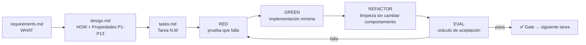

# CLAUDE.md — `weather-forecast-app` (Lab03 · Kiro Specs)

> Contexto operativo para Claude Code (y cualquier agente de IA) que trabaje en este repositorio.
> Este archivo responde tres preguntas: **qué estás construyendo**, **en qué orden avanzas** y **cuándo puedes dar por terminado un trabajo**.
> Las reglas de negocio son normas vinculantes: están en [`BUSSINESS_RULES.md`](./BUSSINESS_RULES.md). El protocolo paso a paso del agente está en [`AGENTS.md`](./AGENTS.md).

---

## 0. Regla de oro

> **Ningún artefacto de código se escribe sin (a) un requisito trazable, (b) una prueba que falle primero y (c) un eval que lo juzgue.**

Si una tarea no puede señalar sus tres anclas (`requirements.md` §Req.N, `design.md` §Propiedad N, `tasks.md` §Tarea N.M), **no se empieza**: primero se completa la especificación.

---

## 1. Qué se está construyendo

Una **SPA estática** (HTML + CSS + TypeScript vanilla, sin backend) que permite a un usuario escribir el nombre de una ciudad y ver el clima actual: **temperatura (°C), humedad relativa (%) y precipitación (mm)**.

Flujo de negocio en tres pasos:

1. El usuario escribe una ciudad y envía (clic en botón o tecla `Enter`).
2. La app resuelve el nombre a coordenadas con la **Geocoding API** de Open-Meteo.
3. Con las coordenadas, consulta la **Forecast API** de Open-Meteo y renderiza el resultado.

Todo el procesamiento ocurre en el navegador. Las APIs de Open-Meteo son públicas, gratuitas, sin API key y con soporte CORS.

---

## 2. Stack tecnológico

| Capa | Tecnología | Nota |
|------|-----------|------|
| Lenguaje | TypeScript (`strict: true`) | Sin `any` implícito; sin `!` sin justificación |
| Build / dev | **Vite** (solo dev server y build; justificado en `design.md` §Decisiones y Tarea 1) | Sin frameworks de UI |
| UI | HTML5 + CSS3 + DOM APIs nativas | Accesibilidad: contraste, foco visible, `label` asociado |
| HTTP | `fetch` nativo + `AbortController` | Timeout de **10 000 ms** en ambos clientes |
| Tests unitarios / componentes | **Vitest** + **@testing-library/dom** | Entorno `jsdom` (decidido en Tarea 1) |
| Property-based testing | **fast-check** | Mínimo **100 iteraciones** por propiedad |
| Evals | Vitest + reporte propio | Ver `tests/evals/` (§6.3); `npm run eval` incluye los `*.prop.test.ts` registrados en el manifest |

**Prohibido** introducir frameworks de UI (React, Svelte, Vue), bundlers pesados (Vite está justificado y permitido), o dependencias de red adicionales sin que la Tarea 1 lo justifique explícitamente en `tasks.md`.

---

## 3. Mapa documental

| Documento | Responde a | Autoridad sobre | Se modifica cuando |
|-----------|------------|-----------------|--------------------|
| `requirements.md` | **QUÉ** — historias de usuario + criterios de aceptación EARS | Necesidad del usuario | Cambia el alcance funcional |
| `design.md` | **CÓMO** — arquitectura, interfaces, propiedades, errores, estrategia de test | Diseño técnico y contratos de código | Cambia una interfaz, un contrato de API o una propiedad |
| `tasks.md` | **QUÉ HACER** — plan de implementación con dependencia entre tareas | Orden y alcance de la implementación | Se re-planifica el trabajo |
| `BUSSINESS_RULES.md` | **QUÉ ES VÁLIDO** — reglas `BR-*` e invariantes | Reglas de negocio, taxonomía de errores | Aparece una regla o una ambigüedad nueva |
| `AGENTS.md` | **CÓMO TRABAJO** — protocolo del agente, gates, DoD | Proceso de ejecución | Cambia el flujo de trabajo |
| `CLAUDE.md` | **CONTEXTO** — este documento | Panorama, stack, comandos | Cambia el stack o el flujo |

### Jerarquía de autoridad ante conflicto

```
BUSSINESS_RULES.md  >  requirements.md  >  design.md  >  tasks.md  >  (código)
```

Si dos documentos se contradicen: gana el más alto **y se corrige el inferior en el mismo commit**, dejando la discrepancia registrada en §4. El código nunca es la fuente de verdad: si el código contradice a un spec, el spec se actualiza (salvo que sea un bug del código, en cuyo caso gana el spec y se arregla el código).

---

## 4. Discrepancias ya resueltas (no re-litigar)

| # | Discrepancia | Resolución | Dónde está registrada |
|---|--------------|-----------|------------------------|
| D1 | `requirements.md` Req. 3.1 nombra el parámetro legacy `relativehumidity_2m`; la API actual usa `relative_humidity_2m` | Se usa **`relative_humidity_2m`** | `design.md` §Data Models, `tasks.md` §Notes, `BUSSINESS_RULES.md` BR-FCT-01 |
| D2 | Req. 4.1 exige el nombre de la API; Req. 4.7 exige fallback al nombre del usuario | El **servicio** preserva el valor crudo; el **fallback** se aplica en la capa de presentación | `BUSSINESS_RULES.md` BR-GEO-04 / BR-UI-05 |
| D3 | ¿Dónde se aplica el formato numérico? | **Solo en presentación** (`formatters.ts`). Servicios almacenan valores crudos | `BUSSINESS_RULES.md` BR-FMT-01 |
| D4 | D1 se resolvió en `design.md` pero `requirements.md` (mayor autoridad) seguía con el nombre legacy | Se **corrigió `requirements.md`** a `relative_humidity_2m` (v1.1) | `requirements.md` Req. 3.1, commit `docs(requirements)` |
| D5 | ¿Quién valida la entrada vacía: formulario o controlador? | **Solo `CitySearchForm`**; el controlador recibe valor ya recortado | `BUSSINESS_RULES.md` BR-UI-10 |
| D6 | ¿Quién traduce error de dominio → mensaje? | **`src/utils/errorMessages.ts`**; `ErrorMessage` solo pinta | `BUSSINESS_RULES.md` §7, `tasks.md` 7.3 |
| D7 | Búsquedas solapadas | **Token de petición** que descarta respuestas obsoletas; sin deshabilitar `City_Input` | Req. 4.8, BR-UI-09 |
| D8 | Coordenadas fuera de rango | `CITY_NOT_FOUND`, sin error nuevo | Req. 3.6, BR-FCT-03 |
| D9 | Pruebas y evals opcionales en `tasks.md` | **Obligatorios** (se retiró `*`) | `tasks.md` §Notes |

> Si el usuario pide cambiar alguna de estas decisiones, se actualizan **todos** los documentos afectados en el mismo cambio.

---

## 5. Estructura de carpetas

### Estado actual (solo especificación)

```
Lab03_Kiro_Specs/
├── CLAUDE.md              # ← este archivo
├── AGENTS.md              # protocolo del agente
├── BUSSINESS_RULES.md     # reglas de negocio
├── requirements.md        # spec de requisitos
├── design.md              # spec de diseño
└── tasks.md               # plan de implementación
```

### Estado objetivo (implementación)

```
Lab03_Kiro_Specs/
├── CLAUDE.md
├── AGENTS.md
├── BUSSINESS_RULES.md
├── requirements.md
├── design.md
├── tasks.md
├── vite.config.ts             # Vite + Vitest (entorno jsdom)
├── index.html                 # SPA: formulario, zona de carga, zona de error, zona de clima
├── package.json               # scripts: test / eval / typecheck / verify
├── tsconfig.json              # strict: true
├── src/
│   ├── main.ts                # punto de entrada: resuelve los contenedores del DOM
│   ├── app.ts                 # composition root: instancia y cablea las capas
│   ├── config.ts              # API_TIMEOUT_MS, URLs base, CURRENT_FIELDS
│   ├── WeatherController.ts   # orquestador del flujo
│   ├── styles.css
│   ├── types/index.ts         # Coordinates, WeatherData, AppState, tipos discriminados
│   ├── clients/
│   │   ├── GeocodingClient.ts # URL + timeout 10s → Response | throw
│   │   ├── ForecastClient.ts
│   │   └── request.ts          # timeout con AbortController + errores tipados (compartido)
│   ├── services/
│   │   ├── GeocodingService.ts
│   │   └── ForecastService.ts
│   ├── components/
│   │   ├── CitySearchForm.ts
│   │   ├── WeatherDisplay.ts
│   │   ├── LoadingIndicator.ts
│   │   └── ErrorMessage.ts
│   └── utils/
│       ├── formatters.ts
│       ├── errorMessages.ts   # error de dominio → mensaje del catálogo
│       └── guards.ts           # isRecord / isFiniteNumber para fronteras JSON
└── tests/
    └── evals/                 # manifest, fixtures, props, contratos y escenarios (EDD)
        ├── evals.manifest.ts
        ├── fixtures.ts
        ├── props.ts
        └── manifest.eval.test.ts
```

**Regla de testing:** los archivos de prueba van **colocados junto al código** (`src/services/GeocodingService.test.ts`), tal como define `design.md` §Estructura de Archivos de Test. Solo el harness de evals vive en `tests/evals/`.

| Sufijo del archivo | Tipo | Herramienta |
|--------------------|------|-------------|
| `*.test.ts` | Ejemplo / unitario / componente | Vitest |
| `*.prop.test.ts` | Propiedad (fast-check) | Vitest + fast-check |
| `*.e2e.test.ts` | Integración extremo a extremo con clientes mockeados | Vitest + Testing Library |
| `tests/evals/*.eval.test.ts` | Eval de aceptación (oráculo ejecutable) | Vitest |

---

## 6. Flujo de trabajo: Spec-Driven + TDD + EDD

Las tres metodologías **no compiten**, se encadenan. Cada una cubre una debilidad de la anterior:

| Metodología | Responde | Artefacto que produce |
|-------------|----------|------------------------|
| **Spec-Driven** (Kiro) | ¿Qué debe hacer el sistema y por qué? | `requirements.md` → `design.md` → `tasks.md` |
| **TDD** | ¿Funciona el comportamiento esperado? | Pruebas de ejemplo (`*.test.ts`) escritas **antes** del código |
| **EDD** | ¿Es *correcto en general* y no solo en los casos que probé? | Evals ejecutables: propiedades, contratos y escenarios dorados |



### 6.1 Fase SPEC (obligatoria antes de codificar)

1. Leer `requirements.md` completo. Cada criterio de aceptación es EARS (`CUANDO`/`SI`/`MIENTRAS`/`LA App DEBERÁ`).
2. Leer `design.md` completo. Las **Correctness Properties** (P1–P13) son el contrato formal.
3. Leer `BUSSINESS_RULES.md`. Las reglas `BR-*` son invariantes que no se negocian por implementación.
4. Localizar la tarea en `tasks.md` y confirmar sus dependencias (ver §Task Dependency Graph).
5. Si el requisito es ambiguo: **parar y preguntar**; nunca inventar comportamiento.

### 6.2 Fase TDD (por tarea)

Ciclo estricto **RED → GREEN → REFACTOR**:

- **RED:** escribir primero la prueba. Debe fallar por la razón *correcta* (no por un error de compilación o de setup). Registrar la evidencia del fallo (mensaje de error).
- **GREEN:** implementación mínima que hace pasar la prueba. Nada más.
- **REFACTOR:** limpiar diseño y nombres con la suite en verde. Sin cambios de comportamiento.

> En TypeScript con tipos estáticos, el "RED" del compilador **no cuenta** como RED: si el código de producción ni siquiera compila, el fallo es de *setup*, no de comportamiento.

### 6.3 Fase EDD (por tarea)

Un **eval** es un oráculo ejecutable que decide, sin ambigüedad, si una implementación satisface un requisito. Los evals de este proyecto son de tres clases:

| Clase | Qué juzga | Cómo se expresa | Dónde vive |
|-------|-----------|-----------------|------------|
| **Eval de propiedad** | Invariantes universales sobre infinitas entradas | fast-check sobre la Propiedad N de `design.md` | `*.prop.test.ts` |
| **Eval de contrato** | Forma exacta de la URL, nombres de parámetro, códigos HTTP, taxonomía de errores | Aserciones literales sobre la petición/respuesta | `*.eval.test.ts` |
| **Eval de escenario** | Flujo completo observable (dorado / golden) | Traza esperada del DOM con clientes mockeados | `*.e2e.test.ts` + `tests/evals/` |

Cada eval se registra en el **manifest** `tests/evals/evals.manifest.ts` con: `id`, `requisito` (`Req.N.M`), `propiedad` (`P1`–`P13`), `archivo`, `descripción` y `criterio de aprobación`. El comando `npm run eval` ejecuta el suite de evals y emite un reporte; **sale con código ≠ 0 si un solo eval falla**.

**Determinismo:** los evals de propiedad fijan `seed` (`fc.assert(prop, { seed, numRuns })`) tomados de `process.env.FC_SEED ?? <seed por defecto>` para que un fallo sea reproducible.

### 6.4 Quality gates

| Gate | Momento | Criterio de paso | Si falla |
|------|---------|------------------|----------|
| **G0 · Spec** | Antes de codificar | Requisito, propiedad y tarea existen y están trazados | Actualizar spec primero |
| **G1 · RED** | Tras escribir la prueba | La prueba falla por la razón esperada | Arreglar el test, no el código |
| **G2 · GREEN** | Tras implementar | La prueba nueva pasa sin romper las demás | Implementar el mínimo faltante |
| **G3 · Eval** | Tras el refactor | `npm run eval` en verde y manifest completo | Volver a RED |
| **G4 · Tipos** | Antes de cerrar tarea | `npm run typecheck` sin errores | Corregir tipos |
| **G5 · Suite** | Antes de cerrar tarea | `npm test` en verde | Volver a RED |
| **G6 · Review** | Antes de cerrar tarea | Checklist de `AGENTS.md` §6 y `BR-*` respetadas | Iterar |

---

## 7. Comandos

Contrato de scripts (a materializar en la Tarea 1, `package.json`):

```bash
npm install            # instala vitest, fast-check, @testing-library/dom

npm test               # suite completa (unitarias + propiedades + e2e)
npm run test:unit      # solo *.test.ts
npm run test:property  # solo *.prop.test.ts
npm run test:e2e       # solo *.e2e.test.ts
npm run eval           # solo el harness de evals + reporte (EDD)
npm run typecheck      # tsc --noEmit (strict)
npm run verify         # typecheck && test && eval  → el comando de cierre
```

Reglas de uso:

- **Nunca** se declara una tarea "terminada" sin haber corrido `npm run verify` en verde.
- **Nunca** se usa `it.skip` / `xit` / `describe.skip` para silenciar un fallo: se corrige o se documenta el bloqueo en `tasks.md`.
- Los evals no se ejecutan contra la red real: **siempre** con `fetch` mockeado. Las APIs externas no se consideran parte del build.

---

## 8. Convenciones de código

### 8.1 Capas y dependencias

Las dependencias fluyen **hacia abajo**; nunca al revés:

```
Presentación (components)  →  WeatherController  →  Services  →  Clients HTTP
```

- Un **componente de UI** no conoce URLs, ni `fetch`, ni forma de respuesta de la API.
- Un **servicio** no toca el DOM y no conoce la API: recibe datos crudos y devuelve tipos discriminados.
- Un **cliente HTTP** solo construye la URL, aplica el timeout y devuelve la `Response` cruda o lanza el error. No interpreta el cuerpo.
- `main.ts` es el único lugar que instancia y cablea objetos.

### 8.2 Tipos

- `strict: true`. Prohibido `any`. `unknown` + narrowing en fronteras JSON.
- Los resultados de servicio son **tipos discriminados** por `success`:

```typescript
type GeocodingResult =
  | { success: true; data: Coordinates }
  | { success: false; error: GeocodingError };

type GeocodingError =
  | { type: 'CITY_NOT_FOUND' }
  | { type: 'NETWORK_ERROR' }
  | { type: 'TIMEOUT' }
  | { type: 'SERVICE_ERROR'; statusCode: number }
  | { type: 'INVALID_RESPONSE' };
```

- Toda función que cruza una frontera (servicio → controlador) devuelve `Promise<T>` con `T` discriminado, **nunca** lanza por error de negocio. Solo los clientes HTTP lanzan (red/timeout).

### 8.3 Nombres

- PascalCase para clases/tipos, camelCase para funciones/variables, `UPPER_SNAKE` para constantes (`API_TIMEOUT_MS = 10_000`).
- Los archivos de componentes y servicios usan **PascalCase** (`WeatherDisplay.ts`); los de utilidades y tipos, **camelCase/kebab** (`formatters.ts`, `index.ts`).
- Los identificadores de error son literales en `UPPER_SNAKE` y forman parte del contrato: no se renombran sin actualizar `design.md` y `BUSSINESS_RULES.md`.

### 8.4 Formato numérico (presentación)

```typescript
formatTemperature(v)   → (v).toFixed(1) + ' °C'   // máx. 1 decimal
formatHumidity(v)      → Math.round(v) + ' %'     // entero, sin decimales
formatPrecipitation(v) → (v).toFixed(1) + ' mm'   // máx. 1 decimal
```

Los valores **crudos** viajan intactos desde el servicio hasta el formateador. No se redondea, trunca ni transforma en la capa de servicio.

### 8.5 UI y accesibilidad

- El campo de ciudad tiene `maxlength="100"` y un `<label>` asociado.
- Foco visible, contraste suficiente, `aria-live` en la zona de error y en la de carga.
- El `City_Input` **permanece habilitado y accesible ante cualquier error** (Requisito 1.6).
- El contenido del `Weather_Display` se **limpia antes** de cada nueva búsqueda (Requisito 4.6).

### 8.6 Comentarios y idioma

- Código, identificadores y comentarios técnicos en **español**, salvo nombres de librerías o APIs externas.
- Comentarios solo cuando el *qué* no es obvio; el *por qué* sí se documenta.
- Sin TODOs en el código entregado: un TODO es una tarea abierta en `tasks.md`.

---

## 9. Definition of Done

Una tarea está terminada cuando **todo** lo siguiente es cierto:

- [ ] La implementación existe y respeta la arquitectura de `design.md` (capas, tipos, firmas).
- [ ] Hay al menos una prueba **RED-first** que cubre el comportamiento (TDD), y su fallo se documentó antes de implementar.
- [ ] Cada requisito tocado tiene al menos un **eval** en el manifest que lo juzgue (EDD).
- [ ] `npm run typecheck` pasa sin errores ni warnings.
- [ ] `npm test` pasa (unitarias + propiedades + e2e).
- [ ] `npm run eval` pasa y el reporte muestra 0 evals fallidos.
- [ ] Las reglas `BR-*` aplicables se cumplen (ver `BUSSINESS_RULES.md`).
- [ ] Los checkboxes de `tasks.md` correspondientes están marcados, con los requisitos referenciados.
- [ ] No hay `skip`, `only`, `any`, `console.log` de depuración ni código muerto.
- [ ] Si hubo una ambigüedad, se resolvió por escrito en los specs (no solo en el código).

---

## 10. Anti-patrones (prohibidos)

| Anti-patrón | Por qué | Alternativa correcta |
|-------------|---------|----------------------|
| Escribir el código antes que la prueba | Pierde el valor del TDD y del EDD | RED primero, con evidencia del fallo |
| Tests que solo replican la implementación | No detectan errores de lógica | Derivar la aserción del requisito o de la propiedad |
| Probar contra la red real | Tests no deterministas, lentos y frágiles | Mockear `fetch` con fixtures de `design.md` |
| Mutar el valor crudo en el servicio | Rompe el round-trip (Req. 5.1, 5.2) | Formatear solo en `formatters.ts` |
| Cambiar una firma pública sin actualizar `design.md` | Rompe la trazabilidad | Actualizar spec + código en el mismo cambio |
| "Arreglar" un test para que pase | Oculta el defecto | Investigar la causa raíz del fallo |
| `skip` / `only` / `todo` como solución | La suite miente | Dejar la prueba en rojo y escalar |
| Añadir dependencias sin justificar | Rompe el stack acordado | Documentar el motivo en `tasks.md` |
| Mover lógica a un componente | Rompe la separación de responsabilidades | La lógica va en servicio o util; el componente renderiza |

---

## 11. Cheatsheet de arranque

```
1. Leer requirements.md  → qué debe hacer
2. Leer design.md        → cómo está diseñado + Propiedades P1-P13
3. Leer BUSSINESS_RULES.md → reglas BR-* e invariantes
4. Abrir tasks.md        → ubicar la tarea y sus dependencias
5. Escribir la prueba que falla (RED)  → evidencia del fallo
6. Implementar lo mínimo (GREEN)
7. Refactorizar con la suite en verde
8. Registrar el eval en el manifest y correr npm run eval
9. npm run verify → todo en verde
10. Marcar la tarea en tasks.md y cerrar
```

Si en cualquier punto el spec es ambiguo o contradictorio: **parar, preguntar, actualizar el spec**. Un spec ambiguo es un bug de proceso, no una invitación a improvisar.
